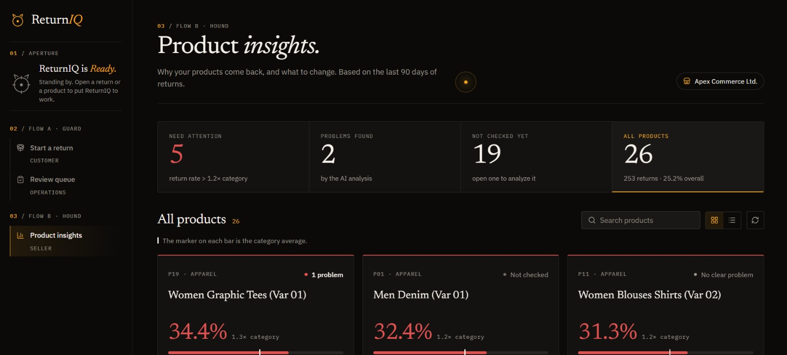
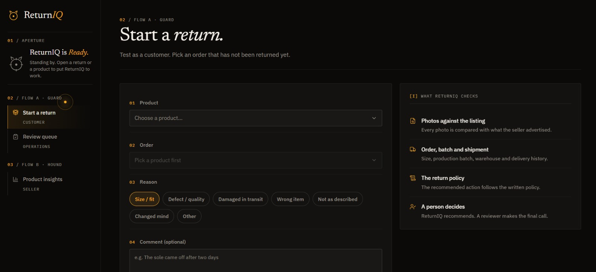
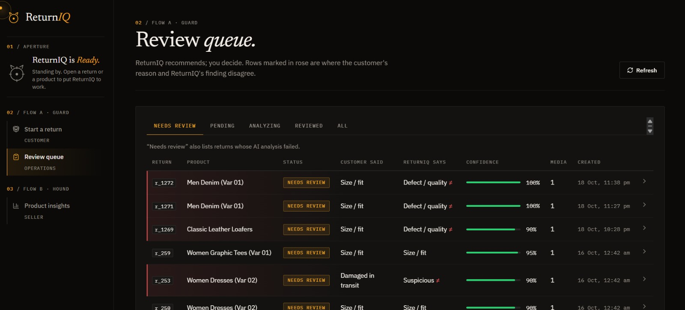
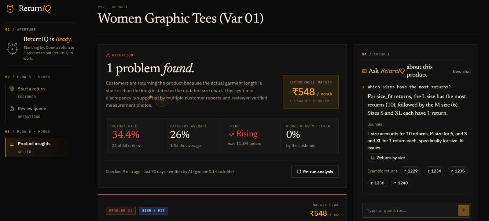
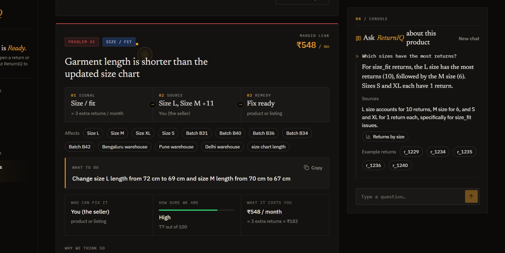

# ReturnIQ : AI-Powered E-Commerce Return Intelligence

> *Sniffing out root causes, protecting your margins.*

**Live prototype:** <https://returniq.cloud.run/> &nbsp;

E-commerce returns bleed **20–35 % of revenue** for online retailers. Each Indian return costs the seller **₹170–₹350** in reverse shipping and handling alone; inspection delays and damaged packaging force **25 %+** of that stock into write-offs, and high return volume eats up to **30 % of net retail margin**. Most sellers find out after the fact - a return-rate chart with no explanation.

ReturnIQ reads every return photo, every customer comment, and every order record, then does two jobs that would otherwise fall to a human:

- **Flow A · Guard** - on each return, a multimodal AI compares the customer's claim against their photos, the listing, the shipment history and policy, and recommends an action for the reviewer to accept or override.
- **Flow B · Hound** - on each product, an agent isolates the root causes of returns with evidence citations, computes the margin leak in rupees, proposes a concrete fix (adjust the size chart, flag a batch, replace a warehouse), and answers follow-up questions from the seller.

Built on the **Google Cloud** stack - **Gemini 2.5 Flash** · **Google ADK** · **Cloud Run** · **AlloyDB / PostgreSQL** · **Firestore** · **Firebase Auth & Storage** · **FastAPI** · **React + Vite**.



> *Seller view - the recoverable-margin counter and the health of every product in one grid.*

## Screens

Three personas, three destinations. The machine-register rail (`01 / APERTURE`, `02 / FLOW A · GUARD`, `03 / FLOW B · HOUND`) is the same across all of them, so the state of the system is always visible while you scroll.

<table>
  <tr>
    <td width="33%" valign="top">
      <a href="docs/screenshots/customer-intake.jpg"></a>
      <p><b>Customer · Start a return</b><br/>
      Numbered form with reason chips and a drop zone for evidence. The side panel states what ReturnIQ will check - and that a person makes the final call.</p>
    </td>
    <td width="33%" valign="top">
      <a href="docs/screenshots/reviewer-queue.jpg"></a>
      <p><b>Reviewer · Review queue</b><br/>
      Ledger of returns awaiting a human decision. A rose rule marks rows where the customer's reason and ReturnIQ's finding disagree, so mismatches surface without reading.</p>
    </td>
    <td width="33%" valign="top">
      <a href="docs/screenshots/product-report.jpg"></a>
      <p><b>Seller · Product report</b><br/>
      Editorial headline, recoverable-margin counter, and a Q&amp;A console that answers from the evidence pack and cites return IDs.</p>
    </td>
  </tr>
</table>

Each root cause is shown as a **scent trail** - signal → source → remedy - with the ready-to-ship fix, who owns it, and the monthly margin leak it represents:



## The problem - three structural failures

| | Failure | What it costs |
|---|---|---|
| **01** | **Blind return authorization.** Legacy portals (Loop, Returnly) print shipping labels automatically with zero photo verification. Shoppers exploit this via wardrobing, worn-item returns and false damage claims; warehouses are flooded with uninspected inventory, delaying refunds for honest customers. | Fraud losses + inspection backlog |
| **02** | **Undetected product flaws.** Inaccurate sizing, specification errors and defective supplier batches drive the majority of returns, but merchants discover these only after hundreds of returns because each return is treated as a one-off shipping transaction. | ~300 recurring returns / size issue |
| **03** | **Severe unit margin loss.** Each return costs **₹170–₹350** in reverse shipping; inspection delays and damaged packaging push **25 %+** of returned stock into write-offs; and high return volume eats up to **30 %** of net retail margin, turning profitable items into losses. | ~₹170–₹350 baseline loss / return |

## Why ReturnIQ is different

Five rules the system enforces in code - not as prompts, but as plumbing:

1. **Code gathers, agents reason.** Breakdowns, counts and rates are precomputed by SQL views and the evidence-pack builder. Agents only call drill-down tools to test specific hypotheses - Flow B's RCA agent is capped at 6 tool calls, Q&A at 5.
2. **Numbers come from code.** Gemini never does arithmetic. Return rates, confidence scores and the ₹ impact are deterministic formulas in Python; the LLM only labels and ranks.
3. **Every claim cites evidence.** Each sentence in a Flow B report must reference an evidence ID (`#BRK-SIZE-04`, `#FB-12`). A code sanitizer drops any claim whose citation does not resolve.
4. **AI recommends, humans decide.** Flow A's verdict never auto-closes a return. The reviewer screen is built around a sticky decision panel; their choice is what sets the final root cause and marks the product's report stale.
5. **Zero fabricated data.** Every agent output passes Pydantic validation. A read-only database role (`returniq_tools`) makes it structurally impossible for an agent to write to the database.

## Architecture

```text
┌─────────────┐     ┌──────────────────────────────────────────────────┐
│  React SPA  │────▸│  FastAPI (app/main.py)                           │
│  (web/)     │◂────│                                                  │
│             │     │  /returns/*          Flow A endpoints            │
│  Customer   │     │  /sellers, /products Flow B endpoints            │
│  Reviewer   │     │  /media/*            Upload / serve media        │
│  Seller     │     │  /demo/*             Dev helpers                 │
└─────────────┘     └────────┬──────────────────────┬──────────────────┘
                             │                      │
                    ┌────────▼────────┐    ┌────────▼────────┐
                    │  Services       │    │  Agents (ADK)   │
                    │  analysis.py    │    │  return_agent   │
                    │  flow_b/        │    │  flow_b_agents  │
                    │   pipeline.py   │    │   rca · solution│
                    │   evidence_pack │    │   · qa · runner │
                    │   scoring.py    │    │  stub models    │
                    └────────┬────────┘    └────────┬────────┘
                             │                      │
                    ┌────────▼──────────────────────▼────────┐
                    │  Tools  (read-only, parameterized SQL) │
                    │  order · catalog · multimodal · policy │
                    │  via returniq_tools role · never writes│
                    └────────────────┬───────────────────────┘
                                     │
                    ┌────────────────▼───────────────────────┐
                    │  PostgreSQL / AlloyDB                   │
                    │  20 tables · 4 views                    │
                    │  returniq_app   R/W   (API only)        │
                    │  returniq_tools R     (agents only)     │
                    └────────────────────────────────────────┘
```

### Tech stack

| Layer | What we use | Why |
|---|---|---|
| **Multimodal AI** | **Google Gemini 2.5 Flash** (via ADK) | Inspects return photos for defects, labels root causes and answers Q&A in **under 850 ms**. ~1,200 tokens per return at ~₹0.035 each. |
| **Agent orchestration** | **Google Agent Development Kit (ADK)** | Orchestrates the RCA, Solution and Q&A agents with strict tool budgets (≤ 6 for RCA, ≤ 5 for Q&A) and offline mock support for CI. |
| **Serverless backend** | **Google Cloud Run** · FastAPI · Python 3.13 · Pydantic | Containerised frontend and backend scale automatically from zero with no idle hosting cost. |
| **Relational database** | **Google AlloyDB / PostgreSQL 16** | 20 tables + 4 analytical views with two strict database roles so the AI tools cannot write. |
| **Real-time state** | **Google Cloud Firestore** | Low-latency store for active agent status, user sessions and real-time interface telemetry. |
| **Auth & media storage** | **Firebase Auth & Storage** | Role-aware auth (Customer / Warehouse Staff / Merchant) and signed upload tokens for return photos. |
| **Frontend** | React 19 · Vite · TypeScript · bundled IBM Plex + Newsreader fonts | `AuraPointer` custom cursor and the reactive Scout aperture; WCAG AA contrast with full keyboard navigation. |
| **Deploy** | Docker + Nginx config for web and server · `REPORT_AS_OF` anchors the 90-day analysis window | Reproducible deployment and evaluation. |

### Flow A - Per-return triage

| Step | Type | What happens |
|---|---|---|
| 1. Submit return | code | Customer picks a reason, writes a comment, uploads photos via signed URLs. Writes `returns`, `return_media`, starts an `agent_run`. |
| 2. Multimodal read | agent | `return_agent` reads order, shipment, listing and photos; cross-checks policy and the product's category profile. |
| 3. Mismatch check | agent | Compares the customer's `stated_reason` against what the photos actually show; sets `reason_mismatch` and `root_cause`. |
| 4. Verdict + evidence | code | Pydantic validates the output; one `media_finding` per photo records defect, severity and listing match. |
| 5. Human review | human | Reviewer accepts, rejects or recuts the root cause. `return_review` is written; the product's Flow B report is marked stale. |

### Flow B - Product-level RCA

| Step | Type | What happens |
|---|---|---|
| 1. Cache check | code | Return the cached report if fresh; a PostgreSQL advisory lock prevents duplicate runs for the same product. |
| 2. Health check | code | Skip the agents entirely if returns < 5 or the rate is within 1.2× the category baseline and not rising. |
| 3. Evidence pack | code | Build 8 pre-computed breakdowns (cause, week, warehouse, batch, variant, mismatch, media findings), fetch feedback and listing changes, assign citable IDs. |
| 4. RCA Agent | agent | Identify root causes that satisfy ≥ 5 returns and ≥ 20 % period share, using up to 6 drill-down tool calls. |
| 5. Solution Agent | agent | Propose exactly one actionable fix per cause, targeted at a catalog attribute, batch or warehouse. |
| 6. Checks & scoring | code | Validate every citation, verify numbers match the evidence, compute a 5-axis confidence score and the ₹ impact. |
| 7. Save & show | code | Persist the report, update the run status, clear the stale flag. The seller can now Q&A against it. |

### Data model at a glance

- **Flow A tables (14):** `seller`, `customer`, `product`, `category_profile`, `policy`, `orders`, `shipment`, `returns`, `return_media`, `agent_run`, `return_analysis`, `media_finding`, `return_review`, `eval_label`.
- **Flow B tables (6):** `cost_model`, `listing_change`, `evidence_pack`, `report_run`, `product_report`, `product_qa`.
- **Views (4):** `v_return_effective_cause` (human decision overrides AI), `v_product_metrics_90d`, `v_category_baseline_90d`, `v_seller_product_list`.
- **Roles (2):** `returniq_app` for API writes, `returniq_tools` for agent reads only.


## Evaluation & system telemetry

Both flows have an offline harness that runs without the Gemini API (`LLM_MODE=stub`), so CI stays deterministic and the daily quota is never a blocker:

- `python -m scripts.eval_flow_a` grades the return agent against ground-truth labels in `eval_label` for mismatch detection (worn items, missing tags, fabricated claims) and policy compliance (return windows, hygiene seals, non-returnable tags).
- `python -m scripts.eval_flow_b` runs Flow B against four planted scenarios - `P01` size-chart discrepancy, `P04` batch defect, `P07` packaging damage, `P11` listing defect - and asserts **zero false alarms** on clean control products. Every generated claim must link to a valid return ID; claims without data proof are discarded.
- Automated unit tests verify that all percentages, return rates and financial metrics match the deterministic formulas.

| Metric | Target |
|---|---|
| Image analysis latency (Gemini Flash Lite) | **< 850 ms** |
| Interactive Q&A response time (incl. tool calls) | **< 2 s** |
| Pipeline concurrency | PostgreSQL advisory locks prevent duplicate runs for the same product |
| CI determinism | 100 % - offline mock agents (`LLM_MODE=stub`) run the full suite without API keys |
| Accessibility | WCAG AA contrast (≥ 4.5:1) with full keyboard navigation |

The `REPORT_AS_OF=2026-10-16` anchor pins the 90-day evaluation window to a fixed date so runs remain reproducible as time passes.

## Key endpoints

Full list with request/response schemas:

| Method | Path | Flow |
|--------|------|------|
| POST | `/media/upload-url` | A - signed upload URL for one photo/video |
| POST | `/returns` | A - submit a return (starts the AI analysis) |
| GET | `/returns?status=awaiting_review` | A - reviewer queue |
| GET | `/returns/{id}` | A - return detail + AI verdict |
| POST | `/returns/{id}/review` | A - human decision (marks the product report stale) |
| POST | `/returns/{id}/reanalyze` | A - rerun the analysis |
| GET | `/sellers` | B - sellers (demo switcher) |
| GET | `/sellers/{id}/products` | B - product list with return rate, top cause, report status |
| GET | `/products/{id}/report` | B - saved report if fresh, otherwise starts a run |
| GET | `/products/{id}/report/runs/{run_id}` | B - run progress, and the report when done (poll every 2–3 s) |
| POST | `/products/{id}/report/refresh` | B - force a new analysis |
| GET | `/products/{id}/evidence-packs/{pack_id}` | B - the evidence a report cites |
| POST | `/products/{id}/questions` | B - ask a question (Q&A) |
| GET | `/products/{id}/questions?session_id=` | B - Q&A history |


## Margin recovery - three levers

Recovered Margin = *Prevented Returns × (Reverse Freight + Restocking + Damaged Write-off)*. Every number is computed in code against the seller's own cost model - zero AI guessing.

| Lever | What it does | Monthly save |
|---|---|---:|
| **01 · Gate protection** | Blocks ~100–150 invalid or fraudulent returns at intake via photo verification. | **₹35,000 – ₹55,000** |
| **02 · Catalog corrections** | Fixing one inaccurate size guide prevents ~300 recurring returns on that SKU. | **~₹90,000** |
| **03 · Defective batch quarantine** | Halting orders on one bad supplier lot prevents ~200 downstream returns. | **~₹60,000** |

**Estimated total: ₹1.8 L – ₹2.5 L / month recoverable** on a 1,000-SKU brand - a **~25×–35× ROI** on the hosting bill.
